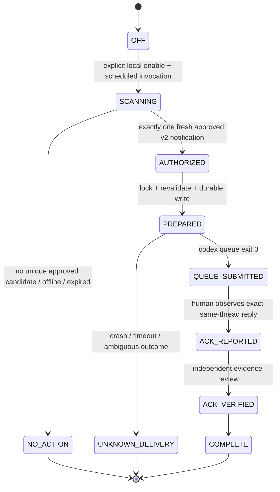

# Personal Workspace — B2B Windows Unattended Notification Polling, Design V1.0

**Status:** DESIGN DRAFT / USER REVIEW REQUIRED — NOT APPROVED; NO B2B CODE, TASK SCHEDULER INSTALLATION OR UNATTENDED DELIVERY AUTHORIZED  
**Date:** 2026-11-21  
**Repo:** `zyyu1/personal-workspace` (private)  
**Proposed scope:** Use a user-owned Windows scheduler to periodically scan the approved GitHub notification inbox and send **notification-only** messages to the **already-pinned existing Codex Desktop thread**, without requiring manual prompt copy/paste.  
**No B3 authority:** GitHub notification is not implementation permission. No automatic code changes, Git commits, PR merges, QA routing, or Modules 007/008 development.

## 0. Accepted dependencies and observed limitations

- **B0** [Issue #3](https://github.com/zyyu1/personal-workspace/issues/3): a one-time `codex queue --thread <EXACT_UUID> --message <FIXED_MESSAGE>` reached the original Windows Codex session.
- **B1** [Issue #4](https://github.com/zyyu1/personal-workspace/issues/4): authenticated GitHub Issues read-only classifier passed on a real Windows `cp936` host with UTF-8 bytes decoding.
- **B2A** [PR #9](https://github.com/zyyu1/personal-workspace/pull/9) (code QA accepted; merged `ca68d1c1f952b3766647e2810e72483dfd5cef2c`) and one-time [Issue #10](https://github.com/zyyu1/personal-workspace/issues/10) live probe: exactly one queue submission, user explicitly confirmed **seeing/copying the matching nonce ACK from the original Codex Desktop conversation**. This is an approved *manual human-attested* ACK, **not** automatic same-thread ACK telemetry.
- [B2_STATUS.md](https://github.com/zyyu1/personal-workspace/blob/main/docs/dispatch/B2_STATUS.md) is the current authority: B2A PASS, local `dispatch_enabled=false`, B2B and B3 NOT AUTHORIZED. Issue #10 is CLOSED, its `dispatch:approved` label revoked. Preserve its one-time outbox entry: no replay or reactivation.
- [Frozen B2 design](https://github.com/zyyu1/personal-workspace/blob/main/docs/dispatch/B2_DESIGN_APPROVED.md) remains authoritative for existing strict v2 authorization rules; this B2B document **proposes an extension**, not a weakening of the B2A trust boundary.
- [B2A sender](https://github.com/zyyu1/personal-workspace/blob/main/tools/dispatch-inbox/b2_notify.py) is operator-invoked, default-disabled and presently accepts **only one eligible live notification** per run; the local outbox and single-instance lock must be retained. No scheduler or watcher is presently installed.

**Goal B2B:** *Automatically check and submit authorized notifications*, not *automatically act on implementation tasks* and not *guarantee that a closed Codex Desktop session has processed the queue*. Actual receipt and ACK remain independently reconciled.

## 1. Operational workflow (V1)

```text
Design Window
  -> reviewed notification authorization record on protected main + exact Git blob SHA
  -> private GitHub Issue (open; allowed author; dispatch:approved; strict v2)
       |
       | outbound GET requests by Windows user process
       v
Windows Task Scheduler (interactive user; interval default PT2M; explicitly enabled)
       |
       v
One finite B2B poll process (no HTTP listener, no long-lived daemon)
  -> local kill switch / config / task identity checks
  -> B1 GET-only client and B2A strict v2 Issue + record + blob validators
  -> enforce mode=probe|notify; mode=implement ALWAYS FORBIDDEN
  -> choose one authorized unique candidate; reject multiple/ambiguous candidates
  -> lock -> fresh GitHub revalidation -> durable PREPARED -> send once
  -> official codex queue --thread <LOCAL_PINNED_UUID> --message <SAFE_TEMPLATE>
  -> QUEUE_SUBMITTED or UNKNOWN_DELIVERY, never automatic ACK_VERIFIED
       |
       v
Existing original Windows Codex Desktop conversation
  -> may respond on the *same thread* after its running turn finishes
  -> manual original-thread ACK evidence / explicit operator reconciliation
```

The system is **outbound-only** from Windows to GitHub, then calls the installed official local Codex CLI. No inbound port or remote execution server. The GitHub Issue is untrusted data, not a command source.

## 2. Windows execution model — proposed default

**Choose Windows Task Scheduler, not a new always-running watcher or Windows SYSTEM service.**

- **A single named Task Scheduler task**, e.g. `PersonalWorkspace-B2B-Notify`, owned by the **same non-admin interactive Windows user** running Codex Desktop. Run only while that user is logged on. No SYSTEM/elevated principal, saved user password, service account, Run whether user is logged on or not, network listener, third-party daemon or new cloud agent.
- **Task creation / enablement requires a separate explicit user/Design Window authorization after B2B code QA.** Developer branch and QA are not permission to register or enable any task. The installer must start `Disabled` and have an operator-verified, reversible `Enable` step after QA and a separately controlled host smoke.
- Trigger: after the user's **interactive logon**, repeat every **2 minutes** (`PT2M`). Minimum allowed 1 minute, configurable only locally after review; default 2 minutes. No wake-the-computer, no catch-up storms, no unbounded polling while logged out. Missed polls during sleep/network outage are safely skipped; a later clean poll reads current state.
- Each scheduled invocation performs **at most one bounded inbox scan and one notification submit attempt**; then exits. **Do not keep a process alive indefinitely**. Windows scheduler setting: **Do not start a new instance** / `IgnoreNew`. A separate existing local process lock is also required; treat the scheduler setting alone as insufficient.
- Windows task must pin an **absolute reviewed** Python interpreter and script, working directory under the trusted repository checkout, expected logged-in owner and user-local config; no `cmd /c`, shell interpolation, loose search PATH, dynamic GitHub-supplied executable, current branch changes or auto-pulls inside the scheduled process.
- Absolute source and executable locations may be private/local only; **never place private user paths, session UUID or tokens in Github Issue/task description/logs**. The registered task action cannot contain the target UUID or secrets. Require the repository checkout at a QA-accepted commit or a verified reviewed release artifact; unattended `git pull` is disallowed.
- A practical **scheduler-level execution-time bound** and per-process/network timeout must be designed and verified on the actual Windows host. A stuck job must not hold an unbounded running process. Termination may leave an UNKNOWN/PREPARED marker; **never resend automatically** on restart.
- Minimal host metadata: last safe poll time, last result code, failure count, enabled/disabled, last accepted source version; no raw Issue body, raw auth transcript, full session identifier or secret. Restrict folder permissions to the Windows user.

Reference docs:
- Microsoft Task Scheduler interval schema: https://learn.microsoft.com/en-us/windows/win32/taskschd/taskschedulerschema-interval-repetitiontype-element
- Windows `schtasks` syntax: https://learn.microsoft.com/en-us/windows-server/administration/windows-commands/schtasks-create
- Task scheduler interactive logon: https://learn.microsoft.com/en-us/windows/win32/taskschd/taskfolder-registertaskdefinition

## 3. Permission & authorization model

1. **Off-by-default:** both scheduler task `Disabled` and local `dispatch_enabled=false` initially. Enabling requires two deliberate actions and an explicit user-approved B2B operational instruction. Disabling either halts future sends.
2. **GitHub read-only:** reuse B1 `gh api --method GET`; no repository write scopes added for B2B. No automatic GitHub Issue comments, labels, closes, PRs, Git operations or branch updates from poller.
3. **Current B2A strict schema v2:** exact typed Issue and manifest fields; allowed author/repo, open state, `dispatch:approved`, exact `main` record path/blob SHA, handoff path/blob SHA, expiry, approved notification-only mode/template. An Issue label alone never authorizes dispatch. Do not relax the B2A-QA-001 exact-type fix.
4. **Untrusted Issue text is never a prompt or a shell argument:** Codex receives the fixed, bounded B2A notification template with strictly validated fields and explicit no-edit/no-implementation instruction.
5. **Target:** same locally pinned original Windows Codex UUID and a verified official executable under the same user. No UUID in GitHub or process output. No `--last`, `--resume`, new sessions, proxy agents, undocumented Desktop database scraping or UI injection.
6. **Mode restriction:** `probe|notify` only. `implement` always forbidden even if Module 007 becomes accepted. B2B must not bypass Module 008 blocked implementation status.
7. **Revocation:** before **every send**, within the acquired local lock, refresh the exact Issue open/label/cancel/expiry and canonical manifest and handoff SHAs from GitHub. If refresh fails, **do not send**. After PREPARED/queue, cancellation is best-effort; do not claim queued items are revoked.
8. **Authentication provenance:** `gh` uses the existing interactive user's login; if revoked/not available, fail closed. The pinned main-branch manifest and Git blob SHAs are *integrity checks*, **not a cryptographic signature**: a compromised account able to alter both the Issue and authorized main-branch record can forge a notice. Recommend protected main branch and mandatory review for new manifests, verify actual rules before operation.
9. **Do not rearm consumed tests:** closed/revoked Issue #10 and the original one-shot outbox record must stay consumed. No reset, label re-add, nonce/expiry extension, false ACK or record duplication to generate a new attempt.

## 4. Durable outbox, duplicate and failure policy

- Reuse the already QA-accepted B2A OutboxStore and OneInstanceLock. Key includes `(repo, issue_number, dispatch_id, authorization_blob_sha)`. Continue writing durable `PREPARED` **before** invoking queue.
- **At-most-one automatic submission per unique authorization:** `PREPARED` / `QUEUE_SUBMITTED` / `UNKNOWN_DELIVERY` / `ACK_REPORTED` / `ACK_VERIFIED` / `COMPLETE` all suppress future automatic send. On crash after PREPARED, assume **UNKNOWN_DELIVERY**, never a safe retry.
- **GET retry vs SEND retry are different:** bounded, idempotent GitHub GET retries on network/rate limit may be allowed; once a prepared authorization exists, do not retry queue on timeout/exit ambiguity. Offline errors do not create PREPARED; future scheduled scans may discover still-unexpired tasks, but never bypass global off switch.
- On nonzero queue exit / missing thread / locked/busy thread, record sanitized `UNKNOWN_DELIVERY` or `BLOCKED` according to whether the attempt could have reached Codex; never auto-fallback to another thread or manual `codex queue`.
- If many approved Issues exist, **V1 deliberately blocks all sends** with `MULTIPLE_AUTHORIZED_NOTIFICATIONS` instead of silently choosing one; this is an acknowledged availability constraint. Multi-job ordering, batching or per-authorize delivery queues require a later design amendment and new QA. Operator may resolve the conflict via the ordinary separately approved GitHub design channel; poller does not mutate Issues.
- Do not mistake a stale file lock for an expired job or automatically remove it without process ownership checks. An unexpected stale lock is an operator intervention, not permission to launch another sender.
- B2B must not mutate B1 dry-run receipts as delivery evidence. Keep B1 default behavior backward-compatible, and do not delete the existing B2A Issue #10 outbox entry.
- Local outbox corruption, full disk, failed fsync/atomic rename, unsafe ACL/symlinked path, version mismatch or process overlap => **fail closed before queue**; expose only sanitized result code.

### State diagram



**Important:** `QUEUE_SUBMITTED` is never an automatically proven `DELIVERED` or `ACK_VERIFIED`. B2B does **not** implement an automatic Codex ACK reader. Human inspection and Design Window manual verification remain authoritative until a later separately designed supported thread-events interface passes QA.

## 5. Operator enable / stop / uninstall contract

**Before enabling:** the operator reviews task name, principal/user SID, action full path/args, `PT2M` repetition, max runtime, single-instance policy, account auth, protected main baseline, local config and default `Disabled` state. No credentials, UUID or private profile path may be posted to GitHub.

**Enablement (future B2B operational authorization only):**
1. Stage reviewed code and test on an isolated Windows worktree; do not overwrite active development checkout.
2. Install a **disabled** current-user Task Scheduler definition through an independently QA-accepted tool or reviewable command. Confirm exact registration metadata. No SYSTEM/elevation and no surprise installer side effects.
3. Only after a separate enablement consent: set reviewed local `dispatch_enabled=true` and enable the single Windows task. Run a separately authorized harmless test notification; record safe results. Observe original thread exact nonce ACK manually.
4. Do not turn on general unattended notifications before the dedicated scheduler QA and a limited two-cycle real-host smoke pass.

**Immediate stop / rollback:**
1. Change `dispatch_enabled=false` (first defense), then disable the **exact** named Windows task under the expected user (second defense).
2. If a task is already running, wait/stop it only through a safe operator-controlled action. Verify no process remains; do not kill unrelated Codex Desktop instances. No new queue attempts after disable.
3. Keep outbox records (especially PREPARED/QUEUE_SUBMITTED/UNKNOWN_DELIVERY); never delete to repeat an uncertain notification.
4. Uninstall only the exact named scheduler task after user permission, keeping receipt and historical GitHub evidence. Do not modify Windows startup shortcuts, registry run keys, login shell or global PATH.
5. A central GitHub cancellation is **not** an instant kill switch when the PC is offline or a message is already queued; local disable is authoritative for future sends.

**Operational limitations to document clearly:** no delivery while Windows is asleep/logged out; existing Desktop thread may be unloaded/busy; queue exit zero is not ACK; no remote guaranteed stop; single-active-notification rule may block legitimate concurrent notifications; a compromised GitHub owner account is outside protection of unsigned Markdown authorization files.

## 6. Proposed development workstreams (all blocked until user approves B2B design)

**B2B-Design (NOW):** draft, review, select operating policy. No code, live Issue, new labels, scheduler registration, local config change, or `codex queue`.

**B2B-Code (later separate authorization):**
- New isolated `tools/dispatch-inbox/b2b_poller.py` and scheduler setup/query/disable/uninstall helpers (reviewed dry-run by default). Reuse B1 and B2A strict validators, sender, outbox, lock. Do not turn B2A operator-only CLI into implicit sending.
- Add synthetic-only scheduler metadata checks, mock GitHub/Codex commands, explicit install-with-disabled status, opt-in gating and safe log state. Must not include auto-ACK or implementation dispatch code.
- Existing tests: all B1/B2A 85 Python tests and Workspace 104 tests, plus new B2B cases; typecheck/lint/build/diff checks.
- Open **new PR** on isolated `codex/dispatch-b2b` branch for independent **Review Only** QA. Do not merge automatically.

**B2B-Staging (later separately authorized):** only after code QA ACCEPTED, permit an **operator-run** dry-run on real Windows and an **initially DISABLED** scheduler registration under the interactive account. No live queue or general auto-enable. Submit evidence.

**B2B-Live pilot (later separately authorized):** after staging acceptance, enable the scheduler briefly for a limited **two-poll-window** harmless probe under user supervision, with a unique new approved test Issue and nonce, checking one submission despite repeated polls and exact original-session ACK. Stop and disable after the pilot. Independent QA/design acceptance required before persistent everyday enablement.

**B2B-Production (future separate user opt-in):** only after real-host pilot, approve deliberate long-running user-session schedule, documented kill switch, health checks and rollback. Never automatically upgrade from pilot to production.

**B3:** entirely separate implementation routing design and authorization. B2B does **not** execute a new module's development handoff.

## 7. Proposed B2B independent QA matrix

1. B0/B1/B2A operational accepted history remains intact; original Issue #10 never requeued.
2. Existing 85 B1+B2A Python tests unchanged/passing; B1 `--once --dry-run` still read-only.
3. Default B2B CLI and any scheduler installer are disabled and non-sending.
4. Task principal exact current interactive user; no SYSTEM/admin/noninteractive execution.
5. Exact single task name and absolute verified Python/script/working dir; no shell injection.
6. Logon-trigger / 2-minute repetition metadata matches approved policy; no wake/catch-up storms.
7. Scheduler `IgnoreNew` and local lock independently prevent concurrent submissions.
8. B2B performs a finite bounded poll and exits; no inbound port or persistent daemon.
9. GitHub client remains GET-only; no new scopes, writes or auto-approval.
10. Strict v2 issue, record, handoff and exact-type checks remain intact; expired/cancelled/forged labels fail closed.
11. Revalidate Issue/record/expiry after acquiring lock and before PREPARED.
12. `mode=implement` always blocked; only probe/notify can submit.
13. Hostile Issue body and arbitrary URLs/shell snippets never enter message or process args.
14. Correct local pinned original UUID/owner/executable; no UUID/secret leaks and no `--resume` or fallback sessions.
15. Unique valid Issue may send once; no candidate => no action; multiple => no action.
16. Durable PREPARED journal always recorded before sender invocation.
17. Queue exit 0 => QUEUE_SUBMITTED, never ACK_VERIFIED or GitHub writes.
18. Queue error/crash/timeout => UNKNOWN_DELIVERY and zero automatic resend.
19. Repeated cycles, login/logoff, offline return and reboot cannot resend old approvals or consumed work.
20. Unwritable/corrupt outbox, stale lock, wrong ACL, changed script or config => fail closed.
21. Local kill switch and task disabled each block sending independently.
22. Safe shutdown/uninstall removes only B2B task, preserves receipts and original Codex Desktop.
23. Unicode `cp936`, time zones/expiry, API rate limit, bounded pagination and log sanitization pass.
24. Source/release version pinning, protected main-branch review and GitHub auth hardening validated as applicable.
25. No Module 007/008 application code, new implementation gate or unintended repository source change.
26. All mock/simulation tests, Python compile, npm typecheck/lint/test/build, diff-check pass with recorded real exit codes.
27. Independently verify scheduler registration under the real Windows user, disabled by default.
28. Independently verify limited live two-cycle poll and no duplicate, one original Desktop thread ACK **only after separately authorized pilot**.
29. Confirm schedule disabled again and local `dispatch_enabled=false` after pilot.
30. Automatic ACK is not claimed; any future event-stream ACK verification requires its own design authorization.

Record statuses `PASS / PARTIAL / FAIL / NOT VERIFIED` and strict stop on safety findings. Code QA may accept with tests #27–29 NOT VERIFIED until later host-stage permissions.

## 8. Open design policy for explicit user confirmation

Recommendations (not yet final B2B approval):
- **Windows mechanism:** one per-user, logon-only Task Scheduler task; simple bounded process every 2 minutes, not persistent daemon.
- **Initial production policy:** at most one simultaneously active approved notification; multiple candidates block pending operator resolution.
- **Always-on meaning:** only while the user's Windows interactive session is logged on and running; **not** 24/7 cloud execution.
- **Delivery scope:** `probe|notify` only; code execution remains B3.
- **Receipt/ACK:** send-once journal, manual same-thread nonce verification, no silent automatic retry after uncertain submit.
- **Operator control:** default disabled; reviewed disabled-only install, separate enablement, local disable and exact-task uninstall.
- **Rollout:** design approval -> code/independent QA -> disabled real-host staging -> short two-cycle live pilot -> separate production authorization.

The following **remain NOT AUTHORIZED** in this draft: code implementation, task registration, scheduled polling, real queue sending, automatic GitHub mutations, new module coding, B3 routing. After user approval, freeze `B2B_DESIGN_APPROVED.md` and issue a **new, separate B2B-code-only execution instruction**. A GitHub Draft PR is design feedback only, never an execution dispatch.
